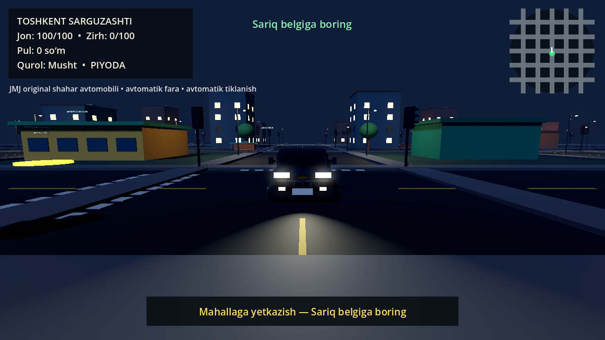
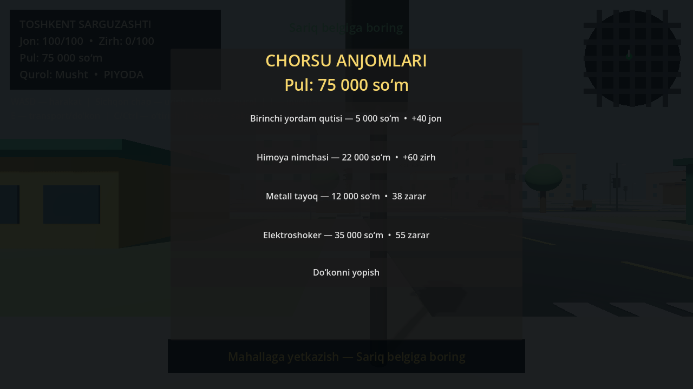

# Toshkent Sarguzashti

`Toshkent Sarguzashti` — Toshkent mahallalari va keng ko‘chalaridan ilhomlangan original 3D ochiq-dunyo MVP o‘yini. Loyiha GTA kodi, xaritasi, modeli, musiqasi, logotipi yoki boshqa aktivlarini ishlatmaydi.







## Ishga tushirish

1. `builds/Toshkent_Sarguzashti_Windows.zip` faylini yuklab oling va alohida papkaga oching.
2. Ichidagi `Toshkent_Sarguzashti.exe` faylini ishga tushiring.
3. Asosiy menyudan **Yangi o‘yin** tugmasini bosing.
4. Sariq topshiriq belgilarini kuzating.

Repository kompyuterga to‘liq joylangan bo‘lsa, root papkadagi `OYINNI_BOSHLASH.cmd` faylini ikki marta bosish ham yetarli.

Talab: 64-bit Windows 10 yoki Windows 11 va OpenGL 3.3 bilan mos videokarta. O‘yin portable: alohida o‘rnatish talab qilmaydi.

Build mustaqil code-signing sertifikati bilan imzolanmagan. Shu sabab Windows SmartScreen ogohlantirish ko‘rsatishi mumkin; fayl yaxlitligini `CHECKSUMS.txt` dagi SHA-256 bilan tekshirish mumkin.

## Boshqaruv

| Tugma | Amal |
|---|---|
| `WASD` yoki strelkalar | Yurish yoki transportni boshqarish; `W` tezlashtiradi, `S` tormozlaydi |
| `Shift` | Yugurish |
| `C` yoki `Ctrl` | O‘tirish va o‘tirgan holda sekin yurish |
| `Space` | Sakrash; transportda qo‘l tormozi |
| Sichqon | Uchinchi shaxs kamerasi; transportda vaqtincha erkin qarash |
| Sichqon chap tugmasi | Musht yoki tanlangan yaqin jang quroli bilan urish |
| `1`, `2`, `3` | Musht, metall tayoq yoki elektroshokerni tanlash |
| `I` | Inventarni ochish yoki yopish |
| `E` | JMJ sedani yoki yaqin trafik mashinasiga kirish/chiqish; yaqin do‘konni ochish |
| `F5` | O‘yinni saqlash |
| `F9` | Saqlangan o‘yinni yuklash |
| `Esc` | Pause menyusi |

## Tayyor imkoniyatlar

- kirish menyusining pastki qismida `by JMJ gems` brend yozuvi;
- 210 × 210 o‘lchamli, 9 ta 70 × 70 mantiqiy chunkka bo‘lingan procedural original shahar;
- 5 × 5 chorraha tarmog‘i, uzun va jihozlardan tozalangan yo‘llar, batafsil fasadlar, piyodalar yo‘laklari, bozor, trotuardagi bekatlar, skameykalar, ko‘cha chiroqlari va daraxtlar;
- doimiy tungi muhit, yoniq bino derazalari, 40 ta real yoritadigan ko‘cha fonari va 17 ta avtomobil farasi;
- yuz, quloq, ko‘z, qosh, burun, kiyim detallari, nafas va bosh harakatlariga ega bo‘g‘inli original 3D personajlar;
- tayyorlanish, zarba va tiklanish bosqichlariga ega gavda bilan bajariladigan yaxshilangan urish animatsiyasi;
- salon, eshik, ikki qavatli panjara, tor faralar, ko‘zgu, raqam va aylanuvchi g‘ildiraklarga ega boshqariladigan original JMJ shahar sedani;
- boshqariladigan JMJ sedani uchun `270 km/soat` maksimal tezlik, kuchli tezlanish va tormoz hamda buzilmas kuzov;
- gaz qo‘yib yuborilganda tezlikni saqlaydigan erkin yurish: mashina faqat `S` yoki `Space` bilan tormozlanadi;
- Chevrolet shahar avtomobillarining umumiy dizayn tilidan ilhomlangan, lekin logotip va tayyor brend aktivlarisiz yaratilgan original kuzovlar;
- transportga kirish/chiqish animatsiyasi, devor ichiga tushirmaydigan xavfsiz chiqish nuqtasi va haydashda avtomatik old tomonga qaytadigan tezlikka mos kamera;
- svetoforda va oldidagi transportga qarab to‘xtaydigan, tiqilib qolsa yo‘lga qaytadigan, zarardan keyin avtomatik tiklanadigan va o‘yinchi `E` bilan egallashi mumkin bo‘lgan 16 ta batafsil trafik avtomobili;
- barcha avtomobillarni tekis yo‘l sathida ushlab turadigan parvozga qarshi barqarorlashtirish;
- turli bo‘y, kiyim va yuzga ega 44 ta bo‘g‘inli piyoda NPC;
- 100 ta ishlaydigan svetofor va xarita chetidagi 4 ta ko‘rinmas fizik to‘siq;
- tezlikka bog‘liq muvozanatli urilish zarari, bir zarbaning qayta-qayta hisoblanishidan himoya, buzilmas boshqariladigan avtomobil, o‘yinchi joni va himoya zirhi;
- o‘yinchi transport ichida bo‘lganida har qanday to‘qnashuvdan jonini to‘liq himoyalaydigan salon modeli;
- NPC joni tugaganda tushadigan yig‘ib olinadigan pul modeli;
- uchta interaktiv do‘kon: dori, zirh, metall tayoq va elektroshoker;
- musht hamda kaftga to‘g‘ri biriktirilgan 3D metall tayoq va elektroshoker, ekrandagi inventar va qurol tanlash;
- JSON orqali yuklanadigan 4 bosqichli topshiriq va mukofot;
- HUD, minimap, asosiy menyu, pause va ovoz sozlamasi;
- jon, zirh, pul, inventar, tanlangan qurol va transport mustahkamligini saqlaydigan `schema_version: 2` save/load tizimi;
- Windows uchun bitta faylli `.exe` build.

## Qotish bo‘yicha tuzatish

`0.4.1` versiyasida ayni AMD Radeon Graphics kompyuterida bir xil avtomatik sahna bilan o‘lchov qilindi:

| Ko‘rsatkich | Oldin | Keyin |
|---|---:|---:|
| O‘rtacha FPS | 7.8 | 29.7 |
| Bir kadrdagi draw call | 4 677 | 537 |
| Bir kadrdagi obyekt | 4 919 | 779 |
| Bir kadrdagi primitive | 5 694 660 | 66 072 |
| Asosiy kadr vaqti | 69.80 ms | 22.63 ms |

Qotishga birgina xato emas, bir nechta yuk sabab bo‘lgan: yuqori segmentli procedural sfera/kapsulalar, yuzlab yo‘l belgilarining alohida chizilishi, 100 svetoforning har kadr material almashtirishi, har bir trafik mashinasining har kadr barcha svetoforlarni qidirishi, 57 ta uzoq masofali real-time chiroq, `glow` va dinamik oy soyasi. Tuzatishda pastroq, ko‘rinishni deyarli o‘zgartirmaydigan mesh segmentlari, `MultiMesh`, masofa bo‘yicha LOD, keshlangan trafik sezgisi, 4 Hz svetofor yangilanishi va kameraga yaqin yoritish qo‘llandi.

Ichki o‘lchovni manba loyihada takrorlash:

```powershell
Godot_v4.7.2-stable_win64_console.exe --path . -- --performance-test
```

## Loyiha tuzilishi

- `scripts/` — GDScript o‘yin kodlari;
- `data/mission_01.json` — data-driven topshiriq;
- `screenshots/` — tekshirilgan preview rasmlari;
- `builds/` — EXE’ni o‘z ichiga olgan ishga tayyor Windows ZIP paketi;
- `REVERSE_ENGINEERING.md` — tadqiqot, dalillar va arxitektura hisoboti.

Standalone `.exe` hajmi GitHub’ning oddiy fayl chegarasidan katta. Shu sabab u repository ichida siqilgan ZIP ko‘rinishida saqlanadi.

## Chegara

Bu tijoriy AAA yoki fotorealistik mahsulot emas, balki batafsillashtirilgan, yakunlangan va o‘ynaladigan vertical-slice prototip. Modellar tashqi tayyor aktivlarsiz Godot ichida original procedural geometriya sifatida qurilgan. Mobil versiya foydalanuvchi qaroriga ko‘ra loyiha doirasidan chiqarilgan. Multiplayer, o‘qotar qurol, jinoyat/qidiruv tizimi va to‘liq Toshkent xaritasi bu versiyaga kirmaydi. FPS qurilma, drayver va sahnadagi kamera holatiga qarab farq qiladi.

Brend, pullik shrift va mualliflik huquqi bilan himoyalangan kontentni ruxsatsiz qo‘shmang. Keyingi barcha 3D model, musiqa va teksturalarning litsenziya dalilini saqlash tavsiya etiladi.
