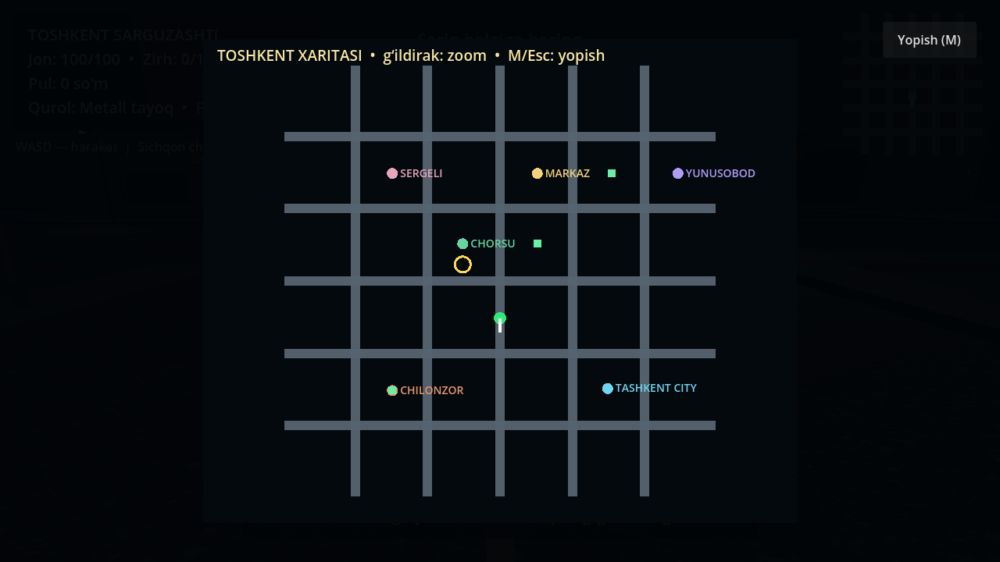
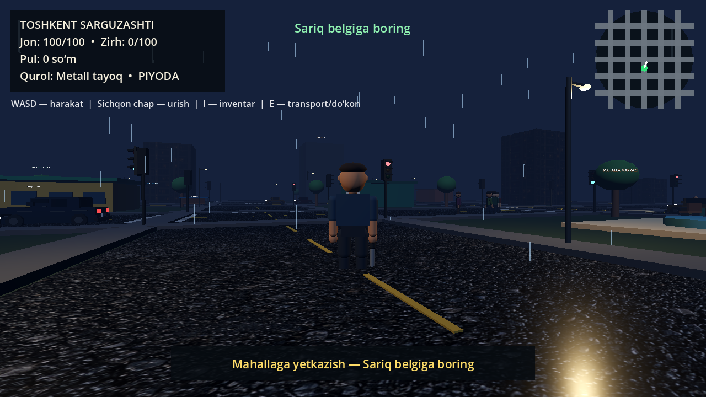
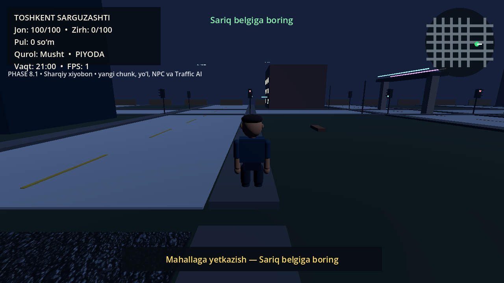

# Toshkent Sarguzashti

`Toshkent Sarguzashti` — Toshkent mahallalari va keng ko‘chalaridan ilhomlangan original 3D ochiq-dunyo MVP o‘yini. Loyiha GTA kodi, xaritasi, modeli, musiqasi, logotipi yoki boshqa aktivlarini ishlatmaydi.

Joriy versiya: `0.8.1 — 140 km/soat transport limiti va salon silueti tuzatishi`.








## Ishga tushirish

1. `builds/Toshkent_Sarguzashti_0.8.1_Windows.zip` faylini yuklab oling va alohida papkaga oching.
2. Ichidagi `Toshkent_Sarguzashti_0.8.1.exe` faylini ishga tushiring.
3. Asosiy menyudan **Yangi o‘yin** tugmasini bosing.
4. Sariq topshiriq belgilarini kuzating.

Repository kompyuterga to‘liq joylangan bo‘lsa, root papkadagi `OYINNI_BOSHLASH.cmd` faylini ikki marta bosish ham yetarli.

Talab: 64-bit Windows 10 yoki Windows 11 va OpenGL 3.3 bilan mos videokarta. O‘yin portable: alohida o‘rnatish talab qilmaydi.

Build mustaqil code-signing sertifikati bilan imzolanmagan. Shu sabab Windows SmartScreen ogohlantirish ko‘rsatishi mumkin; fayl yaxlitligini `CHECKSUMS.txt` dagi SHA-256 bilan tekshirish mumkin.

## Boshqaruv

| Tugma | Amal |
|---|---|
| `WASD` yoki strelkalar | Yurish yoki transportni boshqarish; `W` tezlashtiradi, `S` tormozlaydi |
| `Shift` | Yugurish |
| `C` yoki `Ctrl` | O‘tirish va o‘tirgan holda sekin yurish |
| `Space` | Sakrash; transportda qo‘l tormozi |
| Sichqon | Uchinchi shaxs kamerasi; transportda vaqtincha erkin qarash |
| Sichqon chap tugmasi | Musht yoki tanlangan yaqin jang quroli bilan urish |
| `1`, `2`, `3` | Musht, metall tayoq yoki elektroshokerni tanlash |
| `I` | Inventarni ochish yoki yopish |
| `M` | To‘liq shahar xaritasini ochish yoki yopish; sichqon g‘ildiragi bilan zoom |
| `E` | Transportga kirish/chiqish, do‘kon, interyer, garaj yoki yaqin NPC bilan interaksiya |
| `R` | Muvaffaqiyatsiz topshiriqni qayta boshlash |
| `F6` | Tungi ob-havo rejimini almashtirish |
| `F5` | O‘yinni saqlash |
| `F9` | Saqlangan o‘yinni yuklash |
| `Esc` | Pause menyusi |

## Tayyor imkoniyatlar

- kirish menyusining pastki qismida `by JMJ gems` brend yozuvi;
- 278 × 208 o‘lchamli, 12 ta 70 × 70 mantiqiy chunkka bo‘lingan procedural original shahar;
- eski koordinatalarni saqlagan, yo‘llar bilan uzluksiz bog‘langan uch chunkli Sharqiy xiyobon kengaytmasi;
- yangi mehmonxona, texnologiya minorasi, biznes markazi, savdo uyi, transport markazi, piyoda ko‘prigi va tungi xiyobon;
- o‘yinchi masofasiga qarab shahar chunklarini faollashtiradigan world streaming va LOW/MEDIUM/HIGH radiuslari;
- Markaz, Tashkent City, Chorsu, Chilonzor, Yunusobod va Sergeli hamda Mustaqillik maydoni, Minor, tungi sayilgoh, vokzal, metro va Sharqiy xiyobon uchun 18 ta original procedural landmark;
- 5 × 5 chorraha tarmog‘i, uzun va jihozlardan tozalangan yo‘llar, batafsil fasadlar, piyodalar yo‘laklari, bozor, trotuardagi bekatlar, skameykalar, ko‘cha chiroqlari va daraxtlar;
- doimiy tungi muhit, yoniq bino derazalari, 40 ta real yoritadigan ko‘cha fonari va 17 ta avtomobil farasi;
- tiniq tun, yengil yomg‘ir, kuchli yomg‘ir, tuman va bulutli tun; yomg‘irda nam asfalt materiali;
- loyiha uchun yaratilgan original asfalt va Toshkent-uslubidagi tungi fasad teksturalari;
- procedural shahar atmosferasi, yomg‘ir, qadam, tezlikka mos motor va UI audio signallari;
- yuz, quloq, ko‘z, qosh, burun, kiyim detallari, nafas va bosh harakatlariga ega bo‘g‘inli original 3D personajlar;
- silliqlangan third-person yaw/pitch kamera, transport obyektlarini ham tekshiradigan `SpringArm3D` collision va boshqarilayotgan avtomobil uchun kamera istisnosi;
- qiyalik va notekis sath uchun `floor snap`, past shift ostida xavfsiz turish tekshiruvi;
- tayyorlanish, zarba va tiklanish bosqichlariga ega gavda bilan bajariladigan yaxshilangan urish animatsiyasi;
- salon, eshik, ikki qavatli panjara, tor faralar, ko‘zgu, raqam va aylanuvchi g‘ildiraklarga ega boshqariladigan original JMJ shahar sedani;
- boshqariladigan JMJ sedani va egallanadigan trafik avtomobillari uchun `140 km/soat` maksimal tezlik, kuchli tezlanish va tormoz hamda buzilmas kuzov;
- salon ichidagi haydovchi silueti: bosh tomdan tashqariga chiqmaydi;
- gaz qo‘yib yuborilganda tezlikni keskin yo‘qotmay, `1.35 m/s²` qarshilik bilan asta-sekin sekinlashadigan erkin yurish; `S` yoki `Space` tez tormozlaydi;
- Chevrolet shahar avtomobillarining umumiy dizayn tilidan ilhomlangan, lekin logotip va tayyor brend aktivlarisiz yaratilgan original kuzovlar;
- transportga kirish/chiqish animatsiyasi, devor ichiga tushirmaydigan xavfsiz chiqish nuqtasi va haydashda avtomatik old tomonga qaytadigan tezlikka mos kamera;
- transportdan tushishda bo‘shliq bilan birga haqiqiy yer, yer qiyaligi va to‘liq personaj kapsulasini tekshiradigan umumiy xavfsizlik moduli;
- 9 ta o‘ng tomonlama waypoint yo‘nalishidan iborat navigation graph bo‘ylab eski va yangi hududda yuradigan, svetoforda va oldidagi transportga qarab to‘xtaydigan hamda o‘yinchi `E` bilan egallashi mumkin bo‘lgan 16 ta trafik avtomobili;
- sedan, hatchback, sportcar, SUV, taxi, bus, minivan, delivery van, fictional patrol va retro kabi 10 ta procedural transport profili;
- barcha avtomobillarni tekis yo‘l sathida ushlab turadigan parvozga qarshi barqarorlashtirish;
- turli bo‘y, kiyim va yuzga ega 44 ta bo‘g‘inli piyoda NPC; musht, tayoq yoki elektroshoker zarbasi ularni kuchga qarab orqaga va havoga uloqtiradi;
- yurish, kutish, suhbat, qochish, zarba va halok holatlariga ega FSM hamda 7 rol: oddiy, sotuvchi, taksi haydovchisi, bekat odami, mahalla aholisi, ishchi va missiya personaji;
- `E` bilan murojaat qilinganda roliga mos original o‘zbekcha qisqa suhbat aytadigan NPC lar;
- 120 ta ishlaydigan svetofor va kengaygan xarita chetidagi 4 ta ko‘rinmas fizik to‘siq;
- tezlikka bog‘liq muvozanatli urilish zarari, bir zarbaning qayta-qayta hisoblanishidan himoya, buzilmas boshqariladigan avtomobil, o‘yinchi joni va himoya zirhi;
- o‘yinchi transport ichida bo‘lganida har qanday to‘qnashuvdan jonini to‘liq himoyalaydigan salon modeli;
- NPC joni tugaganda tushadigan yig‘ib olinadigan pul modeli;
- oziq-ovqat, kiyim, avtosalon, servis, aksessuar va umumiy anjomlardan iborat 6 ta interaktiv do‘kon;
- transport sotib olish, transport holatini saqlash, servis va aksessuar/kiyim inventari;
- ishlaydigan eshiklari bor 3 ta interyer: bozor, servis garaji va Tashkent City ofisi;
- musht hamda kaftga to‘g‘ri biriktirilgan 3D metall tayoq va elektroshoker, ekrandagi inventar va qurol tanlash;
- JSON orqali yuklanadigan 7 ta topshiriq: yetkazish, tungi poyga, shahar sayohati, taksi, buyum yetkazish, garaj va hudud ochish;
- topshiriq taymeri, muvaffaqiyatsizlik holati, `R` bilan retry, suhbat, buyum yig‘ish va virtual mukofotlar;
- HUD, minimap, marker/do‘kon/hudud ikonali to‘liq xarita, asosiy menyu va pause;
- LOW/MEDIUM/HIGH, ob-havo, resolution, fullscreen, VSync, 30/45/60/120 FPS va ovoz sozlamalari;
- fade-in/fade-out va o‘tkazib yuborish imkoniyatiga ega `TOSHKENT SARGUZASHTI — by JMJ gems` intro;
- jon, zirh, pul, ikki turdagi inventar, missiyalar, egalikdagi transportlar, ochilgan hududlar, ob-havo va grafik sozlamalarini saqlaydigan `schema_version: 4` save/load tizimi;
- buzilgan asosiy save o‘rniga tekshirilgan zaxira save’ni yuklash va eski schema 1–3 bilan moslik;
- kelajakda to‘liq tarjimani kengaytirish uchun o‘zbek, rus va ingliz tilli localization arxitekturasi;
- Windows uchun bitta faylli `.exe` build.
- yangi hududni uch kadrda SceneTree-safe bosqichli tayyorlash, keshlangan chunk/yorug‘lik ro‘yxatlari va `MultiMesh` detallar;

## Qotish bo‘yicha tuzatish

`0.8.0` uchun ayni AMD Radeon Graphics kompyuterida bir xil avtomatik sahna bilan qayta o‘lchov qilindi. Oldingi hisobotdagi `48–59 FPS` tarixiy natija bo‘lgani uchun yangi audit baseline’i alohida qayta olindi:

| Ko‘rsatkich | PHASE 8 oldi baseline | PHASE 8 markaz | Sharqiy xiyobon |
|---|---:|---:|---:|
| O‘rtacha FPS | 29.7 | 50.9 | 52.6 |
| Bir kadrdagi draw call | 537 | 443 | 151 |
| Bir kadrdagi obyekt | 820 | 738 | 344 |
| Bir kadrdagi primitive | 57 894 | 46 212 | 14 508 |
| Physics vaqti | 6.39 ms | 5.88 ms | 5.26 ms |
| Process vaqti | 86.88 ms | 24.13 ms | 21.09 ms |

Qotishga birgina xato emas, bir nechta yuk sabab bo‘lgan: katta sinxron procedural dunyo qurilishi, ko‘p alohida render obyektlari va takroriy group qidiruvlari. Tuzatishda yangi hudud bosqichli yaratildi, bezaklar `MultiMesh` bilan birlashtirildi, chunk/yorug‘lik/fara ro‘yxatlari keshlangan va mavjud LOD hamda trafik keshlari saqlandi. FPS qurilma, drayver va kamera holatiga bog‘liq; bu raqamlar kafolat emas.

Ichki o‘lchovni manba loyihada takrorlash:

```powershell
Godot_v4.7.2-stable_win64_console.exe --path . -- --performance-test
```

## Loyiha tuzilishi

- `scripts/` — GDScript o‘yin kodlari;
- `data/mission_01.json`–`data/mission_07.json` — data-driven topshiriqlar;
- `screenshots/` — tekshirilgan preview rasmlari;
- `builds/` — EXE’ni o‘z ichiga olgan ishga tayyor Windows ZIP paketi;
- `REVERSE_ENGINEERING.md` — tadqiqot, dalillar va arxitektura hisoboti.
- `PHASE_0_1_HISOBOT.md` — mavjud loyiha auditi, PHASE 1 o‘zgarishlari, testlar va keyingi yo‘l xaritasi.
- `PHASE_2_HISOBOT.md` — PHASE 2 real kod o‘zgarishlari, testlar va halol cheklovlar.
- `PHASE_3_7_HISOBOT.md` — yangi AI, transport, interyer, iqtisodiyot, missiya va build natijalari.
- `PHASE_8_0_1_HISOBOT.md` — 65 imkoniyat auditi, Sharqiy xiyobon, performance taqqoslashi va keyingi roadmap.

Standalone `.exe` hajmi GitHub’ning oddiy fayl chegarasidan katta. Shu sabab u repository ichida siqilgan ZIP ko‘rinishida saqlanadi.

## Chegara

Bu tijoriy AAA yoki to‘liq fotorealistik mahsulot emas, balki kengaytirilgan va o‘ynaladigan vertical-slice prototip. Modellar Godot ichida original procedural geometriya sifatida qurilgan; professional skeletonli inson va transport `GLB` modellari, mocap AnimationTree, yozib olingan o‘zbekcha ovozlar, liftlar, benzin stansiyasi va to‘liq geografik Toshkent xaritasi hali yo‘q. Mobil versiya foydalanuvchi qaroriga ko‘ra loyiha doirasidan chiqarilgan. Multiplayer, o‘qotar qurol va jinoyat/qidiruv tizimi ham bu versiya doirasiga kiritilmagan. FPS qurilma, drayver va sahnadagi kamera holatiga qarab farq qiladi.

Brend, pullik shrift va mualliflik huquqi bilan himoyalangan kontentni ruxsatsiz qo‘shmang. Keyingi barcha 3D model, musiqa va teksturalarning litsenziya dalilini saqlash tavsiya etiladi.
