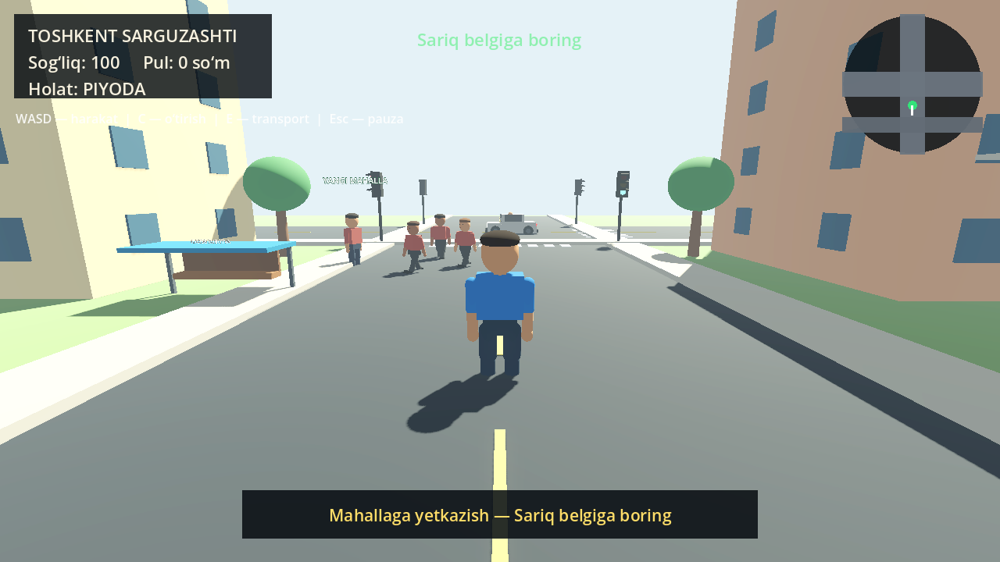
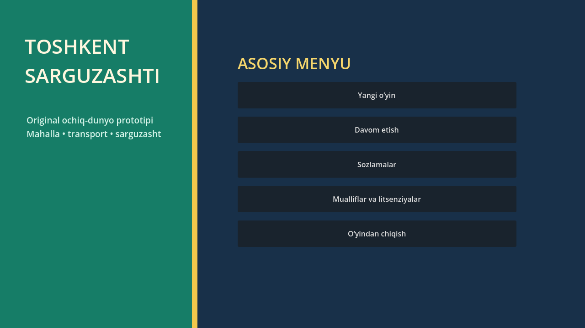

# Toshkent Sarguzashti

`Toshkent Sarguzashti` — Toshkent mahallalari va keng ko‘chalaridan ilhomlangan original 3D ochiq-dunyo MVP o‘yini. Loyiha GTA kodi, xaritasi, modeli, musiqasi, logotipi yoki boshqa aktivlarini ishlatmaydi.

## Ishga tushirish

1. `builds/Toshkent_Sarguzashti_Windows.zip` faylini yuklab oling va alohida papkaga oching.
2. Ichidagi `Toshkent_Sarguzashti.exe` faylini ishga tushiring.
3. Asosiy menyudan **Yangi o‘yin** tugmasini bosing.
4. Sariq topshiriq belgilarini kuzating.

Repository kompyuterga to‘liq joylangan bo‘lsa, root papkadagi `OYINNI_BOSHLASH.cmd` faylini ikki marta bosish ham yetarli.

Talab: 64-bit Windows 10 yoki Windows 11 va OpenGL 3.3 bilan mos videokarta. O‘yin portable: alohida o‘rnatish talab qilmaydi.

Build mustaqil code-signing sertifikati bilan imzolanmagan. Shu sabab Windows SmartScreen ogohlantirish ko‘rsatishi mumkin; fayl yaxlitligini `CHECKSUMS.txt` dagi SHA-256 bilan tekshirish mumkin.

## Boshqaruv

| Tugma | Amal |
|---|---|
| `WASD` yoki strelkalar | Yurish yoki transportni boshqarish |
| `Shift` | Yugurish |
| `C` yoki `Ctrl` | O‘tirish va o‘tirgan holda sekin yurish |
| `Space` | Sakrash; transportda qo‘l tormozi |
| Sichqon | Uchinchi shaxs kamerasi; transportda vaqtincha erkin qarash |
| `E` | Transportga kirish yoki undan chiqish |
| `F5` | O‘yinni saqlash |
| `F9` | Saqlangan o‘yinni yuklash |
| `Esc` | Pause menyusi |

## Tayyor imkoniyatlar

- procedural yaratilgan original shahar: batafsil fasadlar, yo‘llar, piyodalar yo‘laklari, bozor, bekatlar, skameykalar, ko‘cha chiroqlari va daraxtlar;
- bo‘g‘inli original 3D personaj: yurish, yugurish, sakrash, o‘tirish va procedural tana animatsiyasi;
- salon, eshik, chiroq, ko‘zgu, raqam va aylanuvchi g‘ildiraklarga ega boshqariladigan mikroavtobus;
- transportga kirish/chiqish animatsiyasi va haydashda avtomatik old tomonga qaytadigan tezlikka mos kamera;
- svetoforda va oldidagi transportga qarab to‘xtaydigan 10 ta batafsil trafik avtomobili;
- turli bo‘y, kiyim va yuzga ega 28 ta bo‘g‘inli piyoda NPC;
- 36 ta ishlaydigan svetofor va xarita chetidagi 4 ta ko‘rinmas fizik to‘siq;
- JSON orqali yuklanadigan 4 bosqichli topshiriq va mukofot;
- HUD, minimap, asosiy menyu, pause va ovoz sozlamasi;
- versiyalangan save/load tizimi;
- Windows uchun bitta faylli `.exe` build.

## Loyiha tuzilishi

- `scripts/` — GDScript o‘yin kodlari;
- `data/mission_01.json` — data-driven topshiriq;
- `screenshots/` — tekshirilgan preview rasmlari;
- `builds/` — EXE’ni o‘z ichiga olgan ishga tayyor Windows ZIP paketi;
- `REVERSE_ENGINEERING.md` — tadqiqot, dalillar va arxitektura hisoboti.

Standalone `.exe` hajmi GitHub’ning oddiy fayl chegarasidan katta. Shu sabab u repository ichida siqilgan ZIP ko‘rinishida saqlanadi.

## Chegara

Bu tijoriy AAA yoki fotorealistik mahsulot emas, balki batafsillashtirilgan, yakunlangan va o‘ynaladigan vertical-slice prototip. Modellar tashqi tayyor aktivlarsiz Godot ichida original procedural geometriya sifatida qurilgan. Mobil versiya foydalanuvchi qaroriga ko‘ra loyiha doirasidan chiqarilgan. Multiplayer, qurol, jinoyat/qidiruv tizimi va to‘liq Toshkent xaritasi bu versiyaga kirmaydi.

Brend, pullik shrift va mualliflik huquqi bilan himoyalangan kontentni ruxsatsiz qo‘shmang. Keyingi barcha 3D model, musiqa va teksturalarning litsenziya dalilini saqlash tavsiya etiladi.
