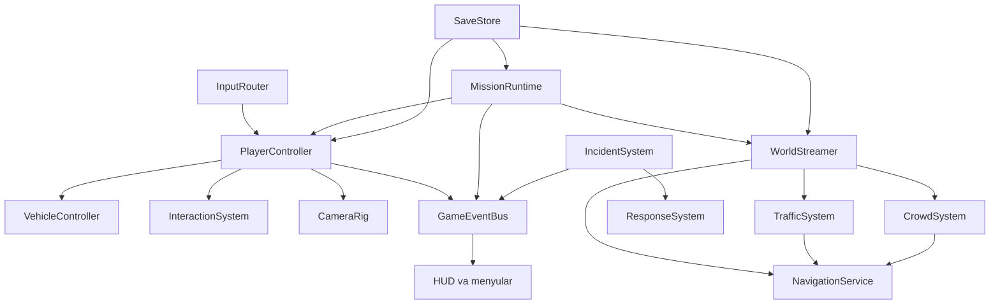

# GTA Vice City bo‘yicha reverse engineering va original Windows MVP

## Maqsad va chegaralar

Ushbu ish faqat o‘rganish va Toshkent hamda O‘zbekiston muhitiga asoslangan mustaqil ochiq-dunyo o‘yini yaratish uchun olib boriladi. GTA nomi, logotipi, kodi, syujeti, xaritasi, personajlari, ovozi, musiqasi, shriftlari yoki boshqa himoyalangan kontent ko‘chirilmaydi. To‘lov yoki litsenziya tekshiruvlari chetlab o‘tilmaydi, begona hisob va ma’lumotlarga kirilmaydi, serverlarga hujum qilinmaydi.

- `[kuzatildi]` Foydalanuvchida Android telefon va Windows noutbuk bor.
- `[kuzatildi]` Maqsad — GTA’ni nusxalash emas, balki O‘zbekiston ko‘chalari va Toshkentga mos original o‘yin yaratish.
- `[kuzatildi]` GTA Vice City foydalanuvchining telefonida qonuniy o‘rnatilgani hozircha tasdiqlanmadi.

## Qisqa reja

1. Rasmiy Rockstar sahifalari va qo‘llanmasidan tasdiqlanadigan o‘yin tizimlari, ekranlar va oqimlarni ajratish.
2. Ichki kod, API yoki ma’lumot modeli artefaktsiz aniqlanmagan bo‘lsa, ularni taxmin sifatida ham faktga aylantirmaslik.
3. Kuzatiladigan mexanikalardan mustaqil Toshkent o‘yini uchun tizim chegaralarini chiqarish.
4. Godot asosidagi original ma’lumot modeli, ichki API va ekranlar oqimini loyihalash.
5. Bir mahallalik vertical slice orqali piyoda yurish, avtomobil, trafik, topshiriq va saqlash tizimini tekshirish.
6. Keyinchalik qonuniy APK yoki Windows artefakti berilsa, REA statik tahlilini alohida dalil qatlamida davom ettirish.

## Muhit

| Topilma | Holat va manba |
|---|---|
| Operatsion tizim | Windows x64, kernel `10.0.26300`; Registry nomi `Windows 10 Home 26H2` — `[kuzatildi]` |
| Protsessor | AMD Ryzen 5 7520U, 8 ta mantiqiy protsessor — `[kuzatildi]` |
| REA | `rea-agents 6.7.0`, skill 42, 207 ta vosita; Codex konfiguratsiyasi sog‘lom — `[kuzatildi]` |
| Android qurilma | REA tekshiruvida va joriy `adb devices -l` natijasida qurilma yo‘q — `[REA: ev_711fc5b552d2c310179e58269fe82c1e20f590ef7948c8f6585fd69ce94dc8e5]`, `[kuzatildi]` |
| Windows GTA o‘rnatmasi | Odatdagi Rockstar Games, Steam va XboxGames joylari hamda Windows uninstall Registry yozuvlarida topilmadi — `[kuzatildi]` |

## Rasmiy paketlar va platformalar

| Nashr | Android | iOS | Freymvork |
|---|---|---|---|
| Grand Theft Auto: Vice City, klassik mobil nashr | `com.rockstargames.gtavc` — `[kuzatildi]` [Google Play](https://play.google.com/store/apps/details?id=com.rockstargames.gtavc) | App Store ID `578448682` — `[kuzatildi]` [App Store](https://apps.apple.com/app/id578448682) | Native C/C++ va RenderWare oilasi bo‘lishi mumkin — `[taxmin]`; artefaktsiz tasdiqlanmadi |
| Grand Theft Auto: Vice City – The Definitive Edition | `com.rockstargames.gtavc.de` — `[kuzatildi]` [Google Play](https://play.google.com/store/apps/details?id=com.rockstargames.gtavc.de) | App Store ID `6468845173` — `[kuzatildi]` [App Store](https://apps.apple.com/app/id6468845173) | Unreal Engine asosida — `[kuzatildi]`; aniq engine versiyasi `aniqlanmadi` |

Tahlil qilinadigan nashr foydalanuvchining telefonida qaysi qonuniy paket borligiga qarab tanlanadi. Hozircha APK olinmagan.

## Vositalar

| Vosita | Holat | Versiya yoki joylashuv |
|---|---|---|
| REA | tayyor | `rea-agents 6.7.0` |
| JDK | tayyor | Temurin `21.0.12.1 LTS` |
| Ghidra | tayyor | `12.1.4` |
| jadx | tayyor | `1.5.6` |
| REA JADX MCP | tayyor | `0.7.1` |
| Apktool | tayyor | `3.0.3`; `[REA: ev_7768e69decc8f6f342d0fb001d6c25474644b6cd520c94333c2f754f7fd79aa8]` |
| Android Platform-Tools / adb | tayyor | `37.0.1`; `[REA: ev_1f285913b290e8a236fcfeb385e872149634176b9ecbfb8fd5f37c8255c32068]` |
| mitmproxy | tayyor | `12.2.3` |
| Python | tayyor | `3.12.10` |
| Frida | tayyor | `17.24.3` |
| frida-tools | tayyor | `14.11.0` |
| Android emulyator | o‘rnatilmadi | Jismoniy Android telefon mavjud; kerak bo‘lsa keyin o‘rnatiladi |
| blutter | hozircha o‘rnatilmadi | Faqat Flutter dalili topilsa kerak bo‘ladi |
| hermes-dec | hozircha o‘rnatilmadi | Faqat React Native/Hermes dalili topilsa kerak bo‘ladi |

Muhitni joriy PowerShell oynasiga ulash:

```powershell
. .\tools\rea-env.ps1
```

## Hozirgi tahlil holati

| Yo‘nalish | Natija | Manba |
|---|---|---|
| APK fayllari | `aniqlanmadi`; telefon ulanmagan | `[kuzatildi]`, `[REA: ev_711fc5b552d2c310179e58269fe82c1e20f590ef7948c8f6585fd69ce94dc8e5]` |
| Freymvork va SDK’lar | Klassik nashr uchun `aniqlanmadi`; Definitive Edition uchun Unreal Engine, versiyasi `aniqlanmadi` | `[kuzatildi]`, `[taxmin]` yuqorida ajratilgan |
| Kod tuzilishi | `aniqlanmadi` | APK olinmagan |
| API endpointlari | `aniqlanmadi` | Statik yoki runtime dalil yo‘q |
| Ma’lumot modeli | `aniqlanmadi` | Statik yoki runtime dalil yo‘q |
| Ekranlar va oqimlar | `aniqlanmadi` | Qurilmada kuzatilmagan |
| Tarmoq trafigi | `aniqlanmadi` | `mitmproxy` kuzatuvi bajarilmagan; certificate pinning bo‘lsa trafik ko‘rinmasligi mumkin |

## Rasmiy manbalardan kuzatilgan o‘yin tuzilishi

Quyidagi bandlar binary dekompilyatsiyasi emas. Ular Rockstar’ning rasmiy mahsulot sahifasi, PS2 qo‘llanmasi va mobil nashr e’lonidan kuzatilgan tashqi xatti-harakatlardir.

### Asosiy dizayn yadrosi

- `[kuzatildi]` Rasmiy tavsif o‘yinni katta shahar muhiti, nochiziqli o‘yin va personajga bog‘langan hikoya birikmasi sifatida ta’riflaydi: [Rockstar — GTA Vice City](https://www.rockstargames.com/games/vicecity).
- `[kuzatildi]` Piyoda va transport holatlari alohida boshqaruv kontekstlariga ega. Piyoda holatida yurish, yugurish, sakrash, transportga kirish, nishonga olish va kamera; transport holatida boshqarish, tezlashish, tormoz, qo‘l tormozi, signal, radio, kamera va transport topshiriqlarini yoqish/o‘chirish mavjud: [Rockstar rasmiy PS2 qo‘llanmasi](https://media.rockstargames.com/rockstargames-newsite/img/manuals/en_us/GTATrilogy_GTAVC_PS2_Manual_M01.pdf).
- `[kuzatildi]` `START` tugmasi Pause Menu’ni ochadi; kamera ko‘rinishini almashtirish piyoda va transport holatida mavjud: [Rockstar rasmiy PS2 qo‘llanmasi](https://media.rockstargames.com/rockstargames-newsite/img/manuals/en_us/GTATrilogy_GTAVC_PS2_Manual_M01.pdf).
- `[kuzatildi]` 10 yillik mobil nashr moslashtiriladigan touch UI, yangi kamera boshqaruvi, yangilangan teksturalar, yuqoriroq resolution va uzoqroq draw distance bilan chiqarilgan: [Rockstar mobil nashr e’loni](https://media.rockstargames.com/broadcast/20121214/en_US_web.html).

### Ekranlar va oqimlar

| Holat yoki ekran | Vice City bo‘yicha dalil | Toshkent loyihasiga olinadigan umumiy saboq |
|---|---|---|
| Gameplay — piyoda | Yurish, sprint, sakrash, transportga kirish, qurol tanlash, kamera va pause boshqaruvi — `[kuzatildi]` | `PlayerOnFoot` holati va kontekstga bog‘liq input xaritasi |
| Gameplay — transportda | Tezlashish, tormoz, rul, qo‘l tormozi, signal, radio, kamera va chiqish — `[kuzatildi]` | `PlayerDriving` holati; bir tugmaning vazifasi kontekstga qarab o‘zgaradi |
| Pause Menu | `START` bilan ochilishi — `[kuzatildi]`; ichki tablar `aniqlanmadi` | O‘yin vaqtini to‘xtatish, xarita, topshiriqlar, sozlamalar va chiqish tablari |
| Kamera ko‘rinishi | Piyoda va transportda almashtirilishi — `[kuzatildi]` | Kamera tizimini personaj/transportdan alohida servis qilish |
| Mobil touch UI | Masshtablanuvchi va moslashtiriladigan UI — `[kuzatildi]` | Tugmalar joylashuvini saqlanadigan profil sifatida yuritish |
| Asosiy menyu tafsilotlari | `aniqlanmadi` | Yangi o‘yin, davom etish, sozlamalar, mualliflar va chiqish |
| Saqlash/yuklash ekrani tafsilotlari | `aniqlanmadi` | Slotlar, versiyalangan save va buzilgan save’dan tiklanish |

### Ichki texnologiyalar bo‘yicha chegaralar

- `[taxmin]` Klassik mobil nashr native C/C++ va RenderWare oilasidan kelib chiqqan bo‘lishi mumkin, lekin tekshiriladigan artefakt bo‘lmagani uchun tasdiqlanmadi.
- `[kuzatildi]` Definitive Edition do‘kon ma’lumotida Unreal Engine ko‘rsatiladi; versiyasi `aniqlanmadi`.
- `[kuzatildi]` Mahalliy Windows o‘rnatmasi va APK yo‘q, shu sabab klasslar, native symbol’lar, engine modullari, endpointlar, save formati va real ma’lumot modeli `aniqlanmadi`.
- `[kuzatildi]` Ommaviy mahsulot sahifalari backend API mavjudligini tasdiqlamaydi. Single-player tizim uchun server API talab qilinishi ham tasdiqlanmadi.

## Toshkent ochiq-dunyo o‘yini: mustaqil texnik loyiha

Bu bo‘lim GTA haqidagi reverse engineering topilmasi emas. Bu kuzatilgan umumiy o‘yin oqimlaridan kelib chiqqan original loyiha taklifidir.

### Tavsiya etilgan texnologiya

- Engine: Godot 4, dastlab GDScript.
- Render: Windows uchun keng moslikni ko‘zlab `Compatibility`.
- Birinchi xarita: butun Toshkent emas, taxminan 1 × 1 km hajmdagi original “Toshkentdan ilhomlangan” tuman.
- World streaming: 200–256 metrlik cell’lar, o‘yinchi atrofidagi 3 × 3 cell faol.
- Nishon: Windows’da 60 FPS; faol piyodalar va transport soni qurilma darajasiga qarab budget bilan boshqariladi.
- Dastlab large-world double precision yoqilmaydi. Godot hujjatiga ko‘ra markazga joylashtirilgan uchinchi shaxs 3D maydoni 8192 × 8192 metrdan oshmasa single precision odatda yetarli: [Godot — Large world coordinates](https://docs.godotengine.org/en/stable/tutorials/physics/large_world_coordinates.html).
- Shahar cell’larini talab bo‘yicha yuklash, LOD/HLOD, occlusion culling, `MultiMesh` va baked lighting ishlatiladi: [Godot — Optimizing 3D performance](https://docs.godotengine.org/en/stable/tutorials/performance/optimizing_3d_performance.html).
- Windows build Godot’ning rasmiy export template’i bilan bitta `.exe` faylga eksport qilinadi.

### Tizim arxitekturasi



Asosiy qoida: UI, mission, transport, trafik va saqlash bir-birining sahna daraxtiga bevosita yopishmaydi; ular identifikatorlar, servis interfeyslari va event’lar orqali aloqa qiladi.

### Taklif etilgan ma’lumot modeli

| Model | Asosiy maydonlar | Vazifa |
|---|---|---|
| `District` | `id`, `display_name`, `cell_ids`, `traffic_profile`, `ambient_profile` | Hudud sozlamasi va cell guruhlari |
| `WorldCell` | `id`, `bounds`, `scene_path`, `nav_region`, `neighbor_ids` | Oqim bilan yuklanadigan dunyo bo‘lagi |
| `RoadNode` | `id`, `position`, `connections`, `signal_group` | Yo‘l grafigidagi tugun |
| `RoadSegment` | `id`, `from`, `to`, `lanes`, `speed_class`, `surface` | Transport yo‘li va harakat qoidalari |
| `PointOfInterest` | `id`, `type`, `position`, `interaction_id`, `unlock_flag` | Do‘kon, ustaxona, bekat yoki topshiriq nuqtasi |
| `VehicleSpec` | `id`, `scene`, `category`, `max_speed`, `acceleration`, `handling`, `seat_count` | Mashina konfiguratsiyasi |
| `NpcArchetype` | `id`, `role`, `visual_set`, `behavior_profile`, `spawn_tags` | Piyoda va xizmat NPC shabloni |
| `MissionDefinition` | `id`, `prerequisites`, `start_trigger`, `stage_ids`, `rewards` | Data-driven topshiriq ta’rifi |
| `MissionStage` | `id`, `type`, `target`, `success`, `failure`, `next_stage` | Topshiriq state machine bosqichi |
| `PlayerState` | `transform`, `health`, `money`, `inventory`, `current_vehicle_id` | O‘yinchining saqlanadigan holati |
| `WorldState` | `time`, `weather`, `flags`, `owned_items`, `parked_vehicles` | Dunyodagi davomli o‘zgarishlar |
| `SaveGame` | `schema_version`, `timestamp`, `player`, `world`, `missions` | Versiyalangan saqlash konteyneri |
| `AssetLicense` | `asset_id`, `source`, `author`, `license`, `proof_path` | Har bir aktivning huquqiy kelib chiqishi |

Tavsiyaviy `MissionDefinition` namunasi:

```json
{
  "id": "mahalla_yetkazish_01",
  "prerequisites": [],
  "start_trigger": "poi:chorsu_ombor",
  "stages": [
    {"id": "transport_ol", "type": "enter_vehicle", "target": "vehicle:damas_01", "next": "manzilga_bor"},
    {"id": "manzilga_bor", "type": "reach_area", "target": "area:mahalla_darvoza", "time_limit_sec": 180, "next": "topshir"},
    {"id": "topshir", "type": "interact", "target": "npc:qabulchi", "next": null}
  ],
  "rewards": {"money": 25000, "flags": ["mahalla_yetkazish_tugadi"]}
}
```

Nomlar va joylashuvlar faqat loyiha namunasi; real brend yoki shaxslar ishlatilmaydi.

### Ichki API chegaralari

Bu yerda “API” internet endpointi emas, o‘yin modullari orasidagi barqaror shartnomadir.

| Servis | Minimal interfeys |
|---|---|
| `IWorldStreaming` | `update_focus(position)`, `request_cell(id)`, `release_cell(id)` |
| `INavigation` | `find_path(from, to, agent_type)`, `register_region(cell_id)` |
| `ITraffic` | `set_budget(count)`, `spawn_near(position)`, `despawn_far(position)` |
| `ICrowd` | `set_budget(count)`, `request_archetype(tags)`, `report_density(area)` |
| `IMissionRuntime` | `can_start(id)`, `start(id)`, `signal(event)`, `get_active()` |
| `IIncidentSystem` | `report(type, position, severity)`, `clear(source_id)` |
| `ISaveStore` | `save(slot)`, `load(slot)`, `migrate(schema_version)` |
| `IAudioDirector` | `set_zone(id)`, `set_vehicle_state(state)`, `play_event(id)` |
| `IUiRouter` | `open(screen_id, payload)`, `close(screen_id)`, `set_hud_state(state)` |

MVP’da tashqi backend API kerak emas. Analytics, cloud save yoki multiplayer keyin qo‘shilsa, foydalanuvchi roziligi, maxfiylik siyosati va server autentifikatsiyasi alohida loyiha sifatida ko‘riladi.

### Taklif etilgan ekran oqimi

```text
Boot
  -> Til va accessibility
  -> Asosiy menyu
       -> Davom etish -> Gameplay
       -> Yangi o‘yin -> Kirish sahnasi -> Gameplay
       -> Sozlamalar
       -> Mualliflar va litsenziyalar

Gameplay
  -> Piyoda HUD
  -> Transport HUD
  -> Interaction prompt
  -> Topshiriq boshlanishi / natijasi
  -> Pause
       -> Xarita
       -> Topshiriqlar
       -> Sozlamalar
       -> Saqlash / yuklash
       -> Asosiy menyuga chiqish
```

### Vertical slice tartibi

1. Kulrang bloklardan iborat bitta mahalla va 4–6 ta ko‘cha.
2. Uchinchi shaxs yurish, kamera, sprint va interaction.
3. Bitta original avtomobil: kirish/chiqish, haydash, kamera.
4. `RoadNode`/`RoadSegment` grafigida 5–10 ta trafik avtomobili.
5. Navigation orqali 10–20 ta sodda piyoda.
6. Uch bosqichli bitta data-driven topshiriq.
7. Pause, xarita, sozlamalar va save/load.
8. Windows profiling: 60 FPS maqsadi, xotira budgeti va cell streaming.

Keyingi hudud yoki kontent faqat shu vertical slice barqaror ishlagach qo‘shiladi.

## Platforma qarori

`[kuzatildi]` Foydalanuvchi 2026-10-21 kuni mobil versiya kerak emasligini aniq bildirdi. Shu sabab Android eksport profili olib tashlandi, mobil boshqaruv qo‘shilmadi va yakuniy mahsulot faqat Windows `x86_64` uchun tayyorlandi.

## Ekran va runtime bo‘yicha qo‘shimcha dalil

Statik APK tahliliga qo‘shimcha ravishda foydalanuvchi o‘z qurilmasida o‘yin ekranini yozib berishi mumkin. Tarmoq so‘rovlari `mitmproxy` orqali kuzatilishi mumkin, ammo certificate pinning bo‘lsa ochiq trafik olinmasligi ehtimoli bor. Parol yoki karta ma’lumotlari kiritilmaydi va yozib olinmaydi.

## Amalga oshirilgan Windows MVP

Bu bo‘lim taklif emas, ishchi loyiha va bajarilgan avtomatik sinov natijasidir.

| Natija | Holat | Manba |
|---|---|---|
| Godot loyihasi | Tayyor, repository root papkasida | `[kuzatildi]` mahalliy fayllar |
| Procedural shahar | 210 × 210 maydon, 9 ta 70 × 70 mantiqiy chunk, 5 × 5 chorraha tarmog‘i, fasadlar, bozor, bekatlar va ko‘cha jihozlari | `[strings]` `scripts/main.gd`; `[kuzatildi]` real OpenGL preview |
| Personaj | Yurish, sprint, sakrash, o‘tirish, bo‘g‘inli original 3D tana va procedural animatsiya | `[strings]` `scripts/player.gd` |
| Transport | Ochiladigan eshik, salon, haydovchi, gaz, tormoz, rul, kuzov og‘ishi va avtomatik old kamera | `[strings]` `scripts/vehicle.gd`, `scripts/player.gd` |
| Trafik va piyodalar | 16 ta batafsil trafik avtomobili, 44 ta bo‘g‘inli piyoda NPC | `[kuzatildi]` `SELF_TEST_OK` |
| Svetofor va chegara | 100 ta davriy svetofor, trafikning qizilda to‘xtashi va 4 ta ko‘rinmas fizik devor | `[strings]` `scripts/traffic_light.gd`, `scripts/traffic_car.gd`, `scripts/main.gd`; `[kuzatildi]` self-test |
| Zarar tizimi | Transport tezligiga bog‘liq to‘qnashuv zarari, o‘yinchi joni, zirh, avtomobil mustahkamligi va qayta tirilish | `[strings]` `scripts/player.gd`, `scripts/vehicle.gd`, `scripts/traffic_car.gd`, `scripts/main.gd`; `[kuzatildi]` self-test |
| Pul, do‘kon va inventar | NPC joni tugaganda pul pickup’i; 3 ta do‘kon; dori, zirh, metall tayoq va elektroshoker; musht va qurol tanlash | `[strings]` `scripts/money_pickup.gd`, `scripts/store.gd`, `scripts/player.gd`; `[kuzatildi]` self-test va OpenGL do‘kon preview’i |
| Topshiriq | JSON’dan yuklanadigan 4 bosqich, 25 000 so‘m mukofot | `[strings]` `data/mission_01.json`; `[kuzatildi]` self-test |
| UI | Asosiy menyu, HUD, minimap, pause va ovoz sozlamasi | `[kuzatildi]` real OpenGL preview |
| Kirish brendi | Asosiy menyuning chap pastki qismida `by JMJ gems` yozuvi | `[kuzatildi]` `screenshots/preview_menu.png`; `[strings]` `scripts/main.gd` |
| Save/load | `schema_version: 2`; joylashuv, jon, zirh, pul, inventar, tanlangan qurol va transport mustahkamligi | `[kuzatildi]` self-test |
| Windows build | `builds/Toshkent_Sarguzashti.exe` | `[kuzatildi]` Godot export va build self-test |
| Mobil build | Yo‘q | `[kuzatildi]` foydalanuvchi talabi |

Self-test muvaffaqiyat mezoni:

```text
SELF_TEST_OK: dunyo=210x210 chunk=9 transport=1 trafik=16 piyoda=44 svetofor=100 dokon=3 zarar=OK pul_drop=OK inventar=OK qurol=OK kamera=avto_old mission=4 save_v2=OK
```

Preview rasmlari `screenshots/preview.png`, `screenshots/preview_menu.png` va `screenshots/preview_store.png` ichida saqlandi. Ular maket emas: Godot 4.7.2, OpenGL 3.3 Compatibility va AMD Radeon Graphics orqali real ishga tushirilgan sahnadan olindi — `[kuzatildi]`.

`[kuzatildi]` Yakuniy Windows `.exe` faylini REA bilan qo‘shimcha statik ochish urinishida Ghidra o‘rnatmasining `application.properties` fayli acquisition vaqtida o‘zgargani uchun `stable snapshot` olinmadi. Bu urinish yakuniy build haqida dalil bermadi va REA dalil ID’si yaratilmagan; natija o‘ylab topilmadi. Buildning ishga tushishi Godot self-test va `BUILD_EXIT_CODE=0` bilan alohida tasdiqlandi.

Prototip cheklovi: bu o‘ynaladigan vertical slice, butun Toshkentni qamrab olgan tijoriy AAA yoki fotorealistik mahsulot emas. Tana, uy va transport shakllari avvalgidan batafsilroq, ammo tashqi fotorealistik 3D assetlarsiz original procedural geometriya sifatida qurilgan. Multiplayer, qurol va qidiruv tizimi bu nashrda `aniqlanmadi` emas, balki ataylab doiradan tashqarida qoldirilgan.

## Original kontent qoidalari

Bu bandlar reverse engineering xulosasi emas, loyiha uchun huquqiy va ijodiy chegaralardir:

- transport, piyoda harakati, topshiriq tizimi, qidiruv darajasi va ochiq dunyo oqimi kabi umumiy mexanikalarni o‘rganish;
- Toshkent mahallalari, metro atrofi, bozorlari, ko‘p qavatli hududlari va keng ko‘chalaridan ilhomlangan, ammo real xavfsizlikka va shaxsiy hayotga zarar bermaydigan original xarita yaratish;
- barcha kod, 3D model, tekstura, musiqa, dialog, nom va brendingni mustaqil ishlab chiqish yoki tegishli litsenziya bilan olish.

